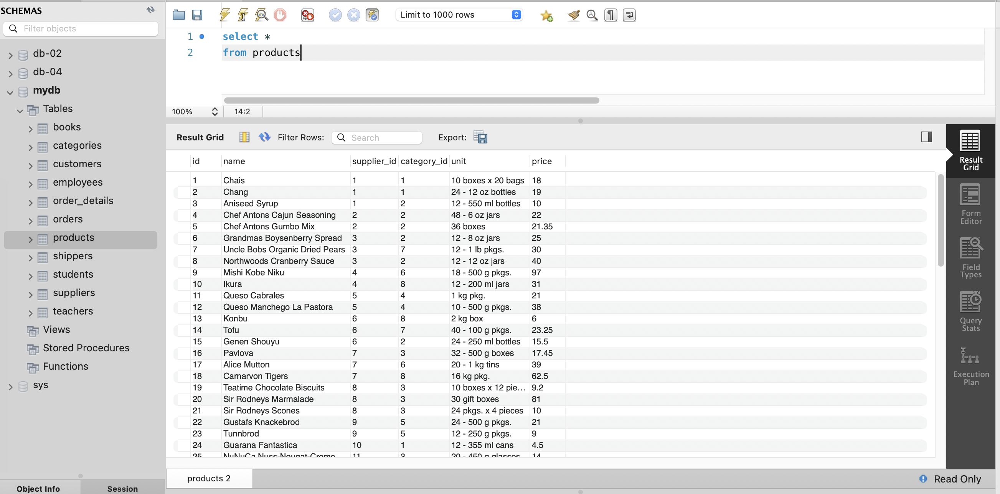
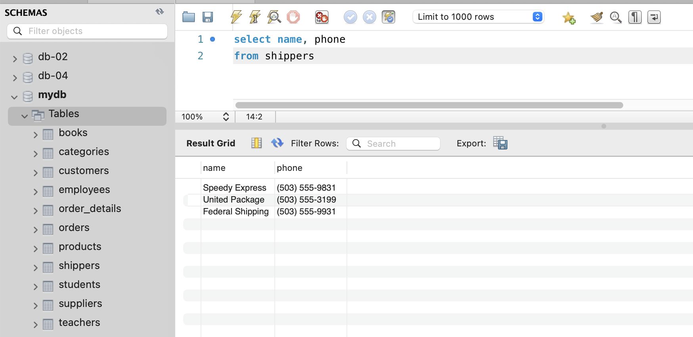
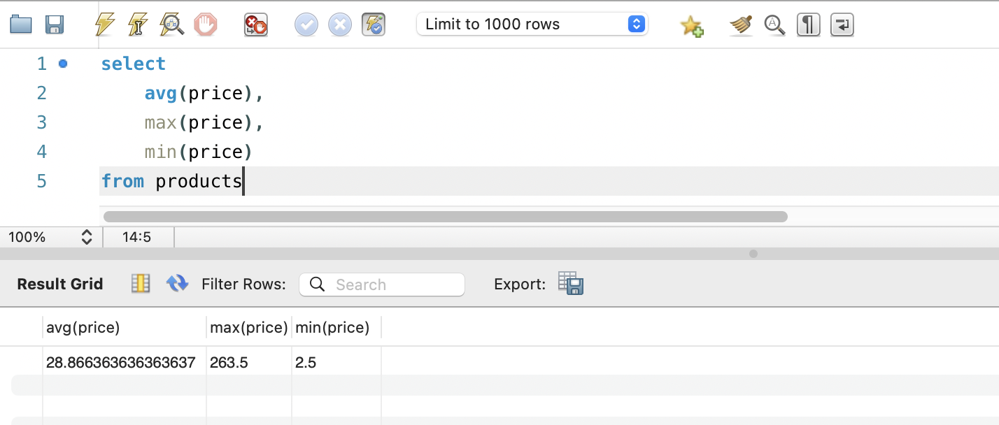
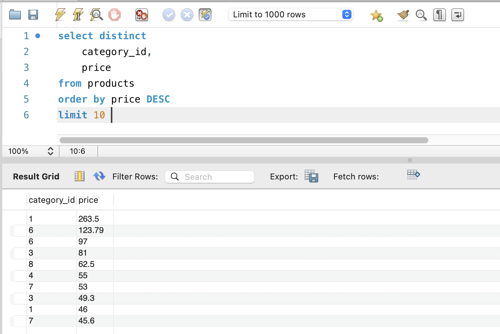
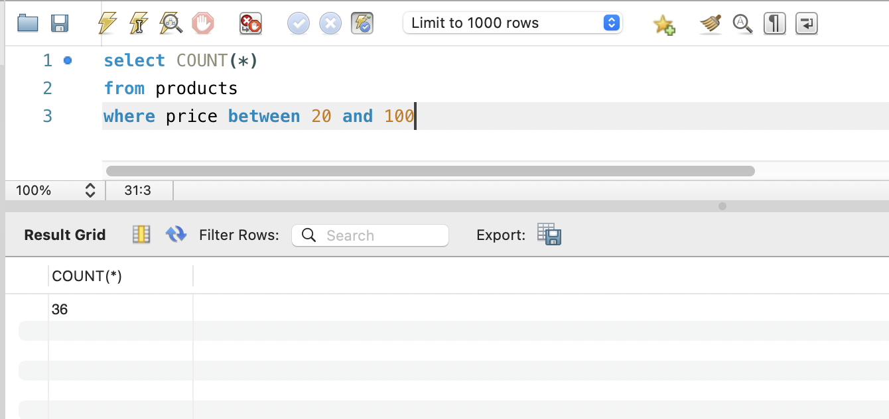
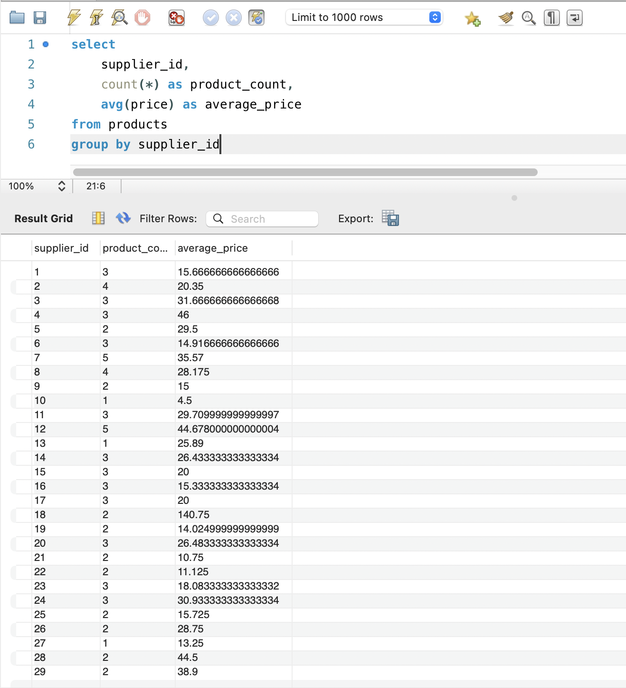

# Домашнє завдання 3 (goit-rdb-hw-03)

## Завдання 1

Напишіть SQL команду, за допомогою якої можна:

1. вибрати всі стовпчики (за допомогою wildcard `*`) з таблиці `products`;
2. вибрати тільки стовпчики `name`, `phone` з таблиці `shippers`.

### Рішення 1.1

```sql
select *
from products
```



### Рішення 1.2

```sql
select name, phone 
from shippers
```



## Завдання 2

Напишіть SQL команду, за допомогою якої можна знайти середнє, максимальне та мінімальне значення стовпчика `price` таблички `products`.

### Рішення 2

```sql
select
    avg(price),
    max(price),
    min(price)
from products
```



## Завдання 3

Напишіть SQL команду, за допомогою якої можна обрати унікальні значення колонок `category_id` та `price` таблиці `products`.
Оберіть порядок виведення на екран за спаданням значення `price` та виберіть тільки 10 рядків.

### Рішення 3

```sql
select distinct
    category_id,
    price 
from products
order by price DESC
limit 10 
```



## Завдання 4

Напишіть SQL команду, за допомогою якої можна знайти кількість продуктів (рядків), які знаходиться в цінових межах від 20 до 100.

### Рішення 4

```sql
select COUNT(*)
from products
where price between 20 and 100
```



## Завдання 5

Напишіть SQL команду, за допомогою якої можна знайти кількість продуктів (рядків) та середню ціну (`price`) у кожного постачальника (`supplier_id`).

### Рішення 5

```sql
select
    supplier_id,
    count(*) as product_count,
    avg(price) as average_price
from products
group by supplier_id
```


